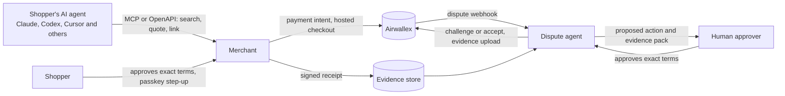

# Dispute Desk

**Chargeback defence for orders placed by AI agents.** An idea for the Airwallex Agentic Banking Hackathon, Dispute Response Agent track.

> **Status: idea phase.** This repository describes the design. The code will be built and published here during the build phase (Oct 25 to Nov 13, 2026). Everything will run against the Airwallex sandbox only. No real money moves.

## The problem

AI agents are starting to buy things for people. That creates a new kind of chargeback. Weeks after an agent places an order, the cardholder tells their bank "I didn't buy this", and the merchant has to prove what the person actually approved.

Today that proof usually does not exist. The agent's conversation is gone, the checkout recorded a payment but not what the human agreed to, and the merchant has one chance to submit evidence before a strict deadline. Every chargeback also carries a fee, whether the merchant fights it or not, so fighting the wrong ones loses money too.

## The idea

Dispute Desk connects two things that are usually separate: **the moment a human approves an agent's purchase**, and **the moment a merchant has to defend that purchase**.

1. **Agent checkout that produces proof.** A shopper's AI agent can search a merchant's catalogue, get a quote and create an approval link. It can never approve or pay. The shopper opens the link, sees the exact items, total, delivery and return terms, approves with a passkey step-up and pays through Airwallex. The merchant then signs a receipt of exactly those terms.

2. **A dispute agent that uses the proof.** When a chargeback arrives through Airwallex, the agent gathers the evidence (the signed receipt, the order, delivery data, order history), reads the customer's messages, and decides whether to **challenge**, **accept** or **hold for a human**. It builds the evidence pack, and **nothing is sent until a person approves the exact action, amount, evidence and deadline**.

## How it works



A dispute moves through fixed states, and every step is recorded:

```
RECEIVED → TRIAGED → ANALYSED → DECIDED → AWAITING_APPROVAL → SUBMITTED → OUTCOME
```

- **Triage** keeps the agent out of disputes Airwallex already handles itself (for example small pre-chargebacks, fully refunded payments, pre-arbitration).
- **Analysis**: an LLM reads the customer's emails and carrier notices **as data, never as instructions**. It extracts claims with exact quotes and flags text that tries to manipulate it. It never decides anything.
- **Decision**: deterministic code applies the evidence checklist for the reason code and a cost rule (expected recovery against fees and effort). Missing or tampered evidence means the agent refuses to challenge.
- **Approval**: a human approves the exact action, amount, evidence pack and deadline. If any of these change, the approval is void.
- **Submission**: exactly one response per dispute, with idempotent request IDs, so a retry can never send twice.

Details: [docs/architecture.md](docs/architecture.md) and [docs/decision-policy.md](docs/decision-policy.md).

## Airwallex APIs

| Need | Airwallex |
|---|---|
| Take the payment | Payment Acceptance: payment intents and hosted checkout |
| Learn about disputes | Payment dispute webhooks, plus listing and reading disputes |
| Submit evidence | Files API upload |
| Respond | Challenge or accept a payment dispute |
| Test end to end | Sandbox dispute simulation endpoint |

## Design principles

- **Money logic lives in code.** The model reads evidence; it never sets amounts, decides, or acts.
- **Approvals are bound to exact terms.** For the shopper (items, total, delivery) and for the merchant's approver (action, amount, evidence, deadline).
- **One terminal action per dispute.** Accept or challenge, never both, never twice.
- **Untrusted text stays data.** Customer messages can contain anything, including instructions aimed at the AI.
- **Honest about what is proven.** A signed receipt proves what was presented and what a session approved, not who the cardholder is. It is one piece of evidence among several.
- **Sandbox only.** A guard refuses any non-sandbox host.

## Works with any agent

The merchant side will be exposed two ways, so any agent can shop:

- an **MCP server** (`search_products`, `get_quote`, `create_approval_link`) for Claude, Codex, Cursor, VS Code, Cline, Gemini CLI and other MCP clients;
- an **OpenAPI** description of the same three operations for function-calling agents (for example on the DeepSeek, Kimi or OpenAI APIs).

Neither offers approve or pay.

## Build plan (Oct 25 to Nov 13)

| Week | Milestone |
|---|---|
| 1 | Core domain: policy engine, signed receipts, approval binding, case runner, audit log and ledger. A local simulator with the documented dispute semantics for fast tests. |
| 2 | Merchant side: catalogue, quotes, approval page, MCP server and OpenAPI. Live Airwallex sandbox adapter: payments, hosted checkout, webhooks with signature checks, disputes, evidence upload. |
| 3 | The full loop live in the sandbox, the desk console, PDF evidence packs, demo scenarios, the demo video and setup docs. |
| Stretch | Sign the shopper's approval with Visa's Trusted Agent Protocol. |

## Demo scenarios

1. An agent buys a kettle, the cardholder later says "I didn't buy this", and the signed receipt plus order history support a challenge, sent after a human approves it.
2. "It never arrived", with no delivery proof yet: the desk holds for a human, then switches to a challenge when the carrier scan arrives.
3. A customer email that tries to instruct the AI: the analyst quotes it, flags it, and the desk refuses to rely on it.
4. A receipt that does not match the order: the desk refuses to challenge and says why.
5. Disputes Airwallex handles itself: the desk stays out and explains why.
