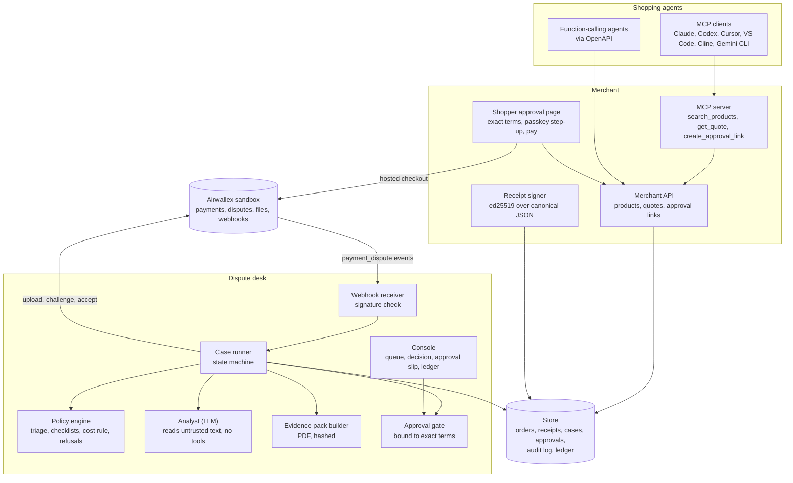
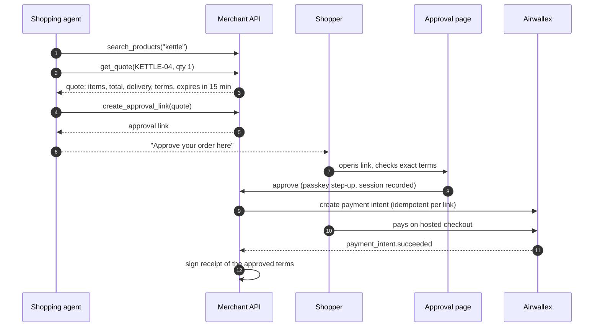
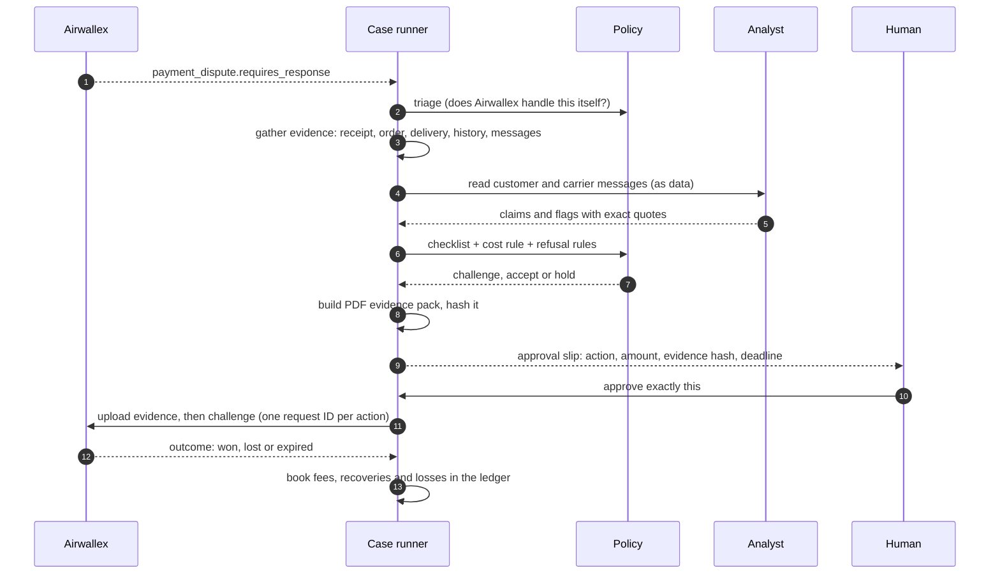

# Architecture

Dispute Desk is one business's system with two sides: the **merchant** that sells to AI agents and records what shoppers approve, and the **desk** that defends that merchant's chargebacks on Airwallex. Both share one store of orders, receipts and cases.

## Components

| Component | Responsibility |
|---|---|
| MCP server | Exposes the merchant to agents as three tools. Writes only protocol messages to stdout. |
| Merchant API | Products, quotes (15-minute expiry), approval links. Also publishes an OpenAPI description of those three operations, built from the same validation rules the endpoints enforce. |
| Approval page | Shows the shopper the exact items, total, delivery address and date, return terms and offer expiry. Approve, then pay. Only the browser session that approved an order can pay for it. |
| Receipt signer | After the payment succeeds, signs a receipt of exactly what was approved and stores it under the payment intent. |
| Webhook receiver | Accepts Airwallex dispute events after verifying their signature, and hands the dispute ID to the case runner. Polling is the fallback. |
| Case runner | Moves each dispute through its states, re-evaluates held cases when evidence changes, and enforces one terminal action per case. |
| Policy engine | Pure, deterministic code: triage, evidence checklists, the cost rule, refusal rules and the deadline cutoff. |
| Analyst | An LLM that reads customer and carrier messages as delimited data and returns schema-checked claims and flags, each with an exact quote. It has no tools and never sees amounts as something it can change. An offline deterministic analyst is used in tests. |
| Evidence pack builder | Produces the PDF (case summary, receipt, order history, delivery proof, terms, timeline) within Airwallex's file limits, and records its hash. |
| Approval gate | Binds a human approval to a hash of case, action, amount, evidence hash and deadline. Any change voids it. |
| Console | The human's view: the queue, the decision with its reasons, the evidence checklist, the receipt, and a tear-off approval slip. |

The domain code talks to Airwallex through **ports** (`PaymentsPort`, `DisputesPort`, `ClockPort`, `AnalystPort`). A live sandbox adapter implements them for the demo, and a local simulator implements the same ports for fast, offline tests.

## Purchase flow

The agent can propose but never approve or pay. One approval link produces at most one order; approving again from the same session returns the same order, and another session is refused.

## Dispute flow

A held case is re-evaluated whenever new evidence arrives (for example a carrier scan). If the deadline is near and evidence is still missing, the case is decided at the cutoff with what exists.

## Data model

| Record | Key fields |
|---|---|
| Quote | id, items (sku, name, qty, unit price), total, delivery address and promised date, return terms, expiry |
| Approval link | token, quote, agent id, URL, expiry |
| Order | id, approval token, payment intent, approver session (session id, IP, user agent, device id), step-up result, status |
| Receipt | receipt id, payment intent, merchant order id, line items, total, delivery terms, quote id and expiry, approval time, approver session, step-up result, agent identity, signature, key id |
| Case | dispute id, payment intent, reason code, stage, amount, deadline, status, evidence snapshot, analyst findings, decision |
| Approval | case, action, amount, evidence hash, deadline, approver, status (pending, approved, voided) |
| Audit event | append-only: every state change, decision, approval and API call |
| Ledger entry | chargeback fee, recovered, lost, accepted loss |

Money is always stored as integer minor units and converted only at the Airwallex boundary.

## Airwallex mapping

| Need | Endpoint |
|---|---|
| Auth | `POST /api/v1/authentication/login` |
| Create and read a payment | `POST /api/v1/pa/payment_intents/create`, `GET /api/v1/pa/payment_intents/{id}` |
| Pay | Hosted payment page |
| Learn about disputes | `payment_dispute.*` webhooks; `GET /api/v1/pa/payment_disputes` and `/{id}` |
| Simulate a dispute (sandbox) | `POST /api/v1/simulation/pa/payment_disputes/create` |
| Upload evidence | `POST /api/v1/files/upload` on the files host |
| Respond | `POST /api/v1/pa/payment_disputes/{id}/challenge`, `/accept` |

## Safety and security

- **Sandbox only.** The live adapter refuses any host that is not an Airwallex sandbox.
- **Keys only in environment files**, never in code or logs. Tokens are redacted from logs.
- **Webhook signatures are verified** before any event is trusted.
- **Untrusted input stays data.** Customer messages are delimited and never followed as instructions; injection attempts are flagged with a quote.
- **The shopper's IP is trusted only behind our own proxy.** Forwarding headers can be set by anyone, so without a trusted proxy the IP is recorded as unknown rather than guessed.
- **What is simulated is labelled.** In the sandbox, the passkey step-up and the customer's prior order history are simulated, and the receipt and evidence pack say so.
